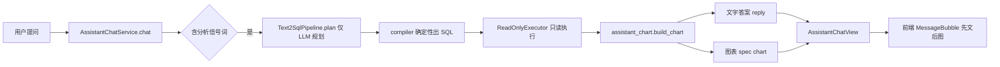

## 需求概述
为 AI 智能助手新增“数据查询后自动生成 ECharts 图表”的能力：用户提出经营分析类问题（如销量趋势、品类占比、工资发放、收支、利润、合同数量对比）时，助手先给出文字回答，随后以图表呈现同一批确定性查询结果。

## 核心功能
- 查询类问题回答后生成图表，覆盖示例场景：单品一周销量趋势、不同饮料销量占比、某员工近五个月工资、近五个月收入与支出、近六个月利润、近六个月签订合同数量对比。
- 严格先文后图：文字回答在上，图表在下，图表数据与文字结论同源。
- 图表类型按问题形态自动选择：时间趋势用折线、占比用饼图、分类对比用柱状。
- 无数据时不生成图表，如实说明“未查询到数据、无法生成图表”；不补点、不插值、不臆造数值。
- 图表在历史会话回看时可还原；草稿类、权限不足、查询失败等场景不出现图表。
- 图表可交互（悬浮提示、图例切换）并自适应容器宽度。

## 视觉要求
图表面板嵌在助手对话气泡内，延续现有界面的克制卡片风格：白底、细边框、圆角、与品牌青绿主色一致的配色；折线带渐变面积、柱状圆角、饼图为环形并显示占比；整体不与文字答案争夺视觉重心。


## 技术栈
- 后端：Python + FastAPI + SQLAlchemy + Pydantic（沿用现有 Text2SQL 语义层体系）
- 前端：React 19 + TypeScript + Tailwind CSS，新增 `echarts`（按需引入）
- 测试：pytest（后端）、vitest + tsc（前端）

## 实现方案

### 数据来源唯一
图表数据只来自 Text2SQL 的确定性查询结果。`_chat_text2sql()` 执行后拿到的 `ExecutedQuery` 已同时包含 `compiled.columns`（`OutputColumn{name, kind, unit, description}`）与 `result.rows`，因此图表生成不需要改动 pipeline、不需要额外调用 LLM，天然做到“文字与图表同源、零额外成本”。

### 图表 spec（确定性生成）
新增 `backend/app/services/assistant_chart.py`，纯函数 `build_chart()`，输入输出固定契约：

```python
class ChartSpec(BaseModel):
    chart_type: Literal["line", "bar", "pie"]
    title: str
    categories: list[str]
    series: list[dict]      # [{"name": 系列名, "data": [数值...]}]
    unit: Literal["box", "money_yuan", "count", "other"]
    note: str | None        # 口径说明/截断提示
```

生成规则（全部确定性，可单测）：
1. 仅当“维度列 1 个 + 指标列 1~2 个”时出图，多维度场景不出图（表格更合适）。
2. 单位换算：`unit == "money"` 转元（分 ÷ 100，保留 2 位）；`box` 保留 2 位；`count` 取整。
3. 类型判定：维度为时间（按月/日维度或列语义为日期）且点数 ≥ 2 → 折线；问题含“占比/比例/构成/分布/结构”且分类数 ≤ 8、数值非负 → 饼图；其余 → 柱状；仅 1 个点 → 柱状。
4. 空 `rows`、数值列全为 null、无可解析分类 → 返回 `None`（不生成图表）。
5. 行数超过 50 时截取前 50 并在 `note` 标注，避免图表不可读。

### “按月”分析能力补齐
当前编译器只按 `time_range` 处理月份，维度只能原样引用列，无法做 `date_trunc`；`semantic_layer.yaml` 也没有财务流水实体，因此示例 4、5 目前无法查询。补齐方式：
- `SemanticDimension` 增加可选 `time_bucket: Literal["day","week","month"]`（默认 `None`，保持既有行为不变），`SemanticCatalog` 校验其仅作用于时间类型列。
- `compiler.py` 在 SELECT / GROUP BY / ORDER BY 中对带 `time_bucket` 的维度生成 `date_trunc('month', t0."biz_date")`，并复用同一表达式保证分组一致。
- `semantic_layer.yaml` 新增维度：销量按月、财务按月、合同按月。
- `semantic_layer.yaml` 新增实体 `finance_transaction`（表 `finance_transactions`：`tx_type`、`amount_fen`、`biz_date`、`source_kind`，`time_column=biz_date`，`dataset_scoped=true`），新增指标：
  - 收入 = `SUM(amount_fen) FILTER (WHERE tx_type='INCOME')`
  - 支出 = `-SUM(amount_fen) FILTER (WHERE tx_type='EXPENSE')`（支出以负数入账，取反为正）
  - 净额 = `SUM(amount_fen)`（与总账口径一致）
- `sales_confirmation` 增加利润指标 `SUM(profit_fen)`，支撑“最近六个月利润”。
- `planner.py` 提示词补充：“按月对比/趋势使用 *_month 维度；最近 N 个月换算为 absolute 起止区间”，现有 `TimeRange.absolute` 已支持。

### 响应与持久化
- `app/schemas/assistant.py` 新增 `AssistantChartView`，`AssistantChatView` 增加可选 `chart`；`api/v1/assistant.py` 通过 `AssistantChatView(**data)` 自动透传，无需改造。
- `assistant_chat_service._response()` 增加 `chart` 参数并写入返回值；`_draft_response()` 与规则/工具路径传 `None`，草稿永不出图。
- 会话持久化：`append_turn(assistant_meta=...)` 已支持任意 meta，仅需把 `chart` 一并写入；历史消息接口回传后前端即可还原。
- 无数据兜底：`tool_status == NO_RECORDS` 时服务端在 reply 末尾追加固定句“未查询到数据，无法生成图表”，不依赖模型自觉，防止出现“有结论无数据”的虚假表述。
- `_TEXT2SQL_SIGNALS` 扩展：工资/薪酬/发薪/应发/实发/收入/支出/净额/利润/毛利/亏损/合同数量/新签/签订，使示例 3、4、5、6 能进入 Text2SQL 路径；仍保持“规则命中优先”的既有路由优先级。

### 前端渲染
- `npm i echarts@^6`，采用 `echarts/core` + 三张图 + 必要组件 + CanvasRenderer 按需注册，避免整包引入。
- 新增 `frontend/src/components/assistant/AssistantChart.tsx`：`useRef` 持有实例，`ResizeObserver` 自适应，卸载时 `dispose()`，数据变化只 `setOption` 不重建。
- `AssistantChat.tsx` 在文字回答 `<p>` 之后、`highlights` 之前渲染图表，满足“先回答再出图”；`chart` 为空时不渲染任何占位。
- `lib/assistant.ts` 增加 `AssistantChart` 类型，并扩展 `AssistantChatResponse.chart` 与 `AssistantSessionMessage.meta.chart`；`toChatMessages()` 还原历史图表。

### 性能与可靠性
- 图表生成复杂度 O(rows)，rows 最多取 50 条，无额外 IO、无额外 LLM 调用。
- `time_bucket` 缺省值不改变既有 SQL，向后兼容现有 Text2SQL 用例。
- 语义层新增实体必须通过 `load_semantic_catalog()` 的引用校验，避免名称/列错配导致运行期失败。
- 若 LLM 规划不可用或超时，沿用现有降级路径，仅返回文字、不返回图表。

## 架构设计


## 目录结构
```
backend/
├── config/
│   └── semantic_layer.yaml                    # [MODIFY] 新增 finance_transaction 实体与收入/支出/净额指标；sales_confirmation 利润指标；销量/财务/合同按月维度
├── app/semantic/
│   └── catalog.py                             # [MODIFY] SemanticDimension 增加 time_bucket 字段与校验（仅时间列可用）
├── app/text2sql/
│   ├── compiler.py                            # [MODIFY] 带 time_bucket 的维度生成 date_trunc 表达式，SELECT/GROUP BY/ORDER BY 保持一致
│   └── planner.py                             # [MODIFY] 提示词补充按月维度选择与“最近 N 个月 → absolute 区间”规则
├── app/services/
│   ├── assistant_chart.py                     # [NEW] 确定性图表 spec 生成：维度/指标识别、单位换算、折线/柱状/饼图判定、空数据返回 None、超量截断
│   └── assistant_chat_service.py              # [MODIFY] _response 增加 chart；_chat_text2sql 调用 build_chart；NO_RECORDS 追加“无法生成图表”；扩展 _TEXT2SQL_SIGNALS；会话 meta 写入 chart
├── app/schemas/
│   └── assistant.py                           # [MODIFY] 新增 AssistantChartView，AssistantChatView 增加可选 chart
└── tests/
    ├── test_assistant_chart.py                # [NEW] 折线/柱状/饼图判定、money 转元、空数据 None、单点降级、50 条截断
    ├── test_semantic_catalog.py               # [MODIFY] 新增实体/指标/按月维度通过校验
    └── test_text2sql_plan.py                  # [MODIFY] 按月维度编译出 date_trunc 且分组一致

frontend/
├── package.json                               # [MODIFY] 增加 echarts 依赖
├── src/lib/
│   └── assistant.ts                           # [MODIFY] 新增 AssistantChart 类型、响应与历史 meta 的 chart 字段
├── src/components/assistant/
│   ├── AssistantChart.tsx                     # [NEW] ECharts 按需注册、自适应、主题配色、饼图占比标签、卸载销毁
│   └── AssistantChat.tsx                      # [MODIFY] 文字回答之后渲染图表；历史消息还原 chart
└── src/components/assistant/
    └── AssistantChart.test.tsx                # [NEW] 渲染/空态/卸载销毁的轻量测试（mock echarts）
```


## 设计风格
延续助手现有界面的克制、专业风格，在对话气泡内追加“数据图表面板”，不改变整体布局与交互习惯。图表面板以白底细边框卡片呈现，与文字答案形成清晰的层级关系：文字为主、图表为辅。

## 页面与区块
助手对话页（Assistant）单页改造，气泡内部自上而下：用户问题、文字回答、图表面板、要点列表（原有）、草稿卡（原有）。图表面板仅在查询有结果时出现，不占用空白占位。

- 图表面板：顶部一行标题（如“近 7 天确认销量（箱）”）与右侧口径标签（按日/按月），下方为图表画布，高度 260px，宽度随气泡自适应。
- 折线图：主色平滑曲线 + 同色渐变面积，数据点仅在悬浮时显示，网格线极淡。
- 柱状图：圆角柱身，主色与浅色交替区分多系列，数值轴留白充足。
- 饼图：环形（内径 55%），扇区间距 2px，标签显示“名称 + 百分比”，中心显示合计值。
- 空态：不出现图表面板，仅在文字末尾以灰色小字提示“未查询到数据，无法生成图表”。

## 交互与动效
- 图表入场淡入上移 120ms，避免突兀。
- 悬浮提示跟随鼠标，显示分类名与数值（金额带“元”、箱数带“箱”）。
- 图例可点击切换系列显隐，饼图点击扇区高亮。
- 容器宽度变化时图表原地重排，不重建实例；切换会话时不残留旧图。

## 响应式
窄屏（<640px）下图表高度降至 220px，标题与口径标签换行排列，标签字号缩小；宽屏保持 260px 并增加左右内边距。

## 配色
沿用品牌青绿主色系，与现有财务趋势图、状态标签保持一致；避免使用高饱和撞色，保证与文字区协调。


## Agent Extensions
### SubAgent
- **code-explorer**
  - Purpose: 在实现阶段快速定位 Text2SQL 编译器、语义层校验与前端助手组件的精确改动点，避免遗漏调用方
  - Expected outcome: 产出按月分桶编译、语义层新增实体、图表 spec 接入点的文件与行号清单，支撑逐项改造
