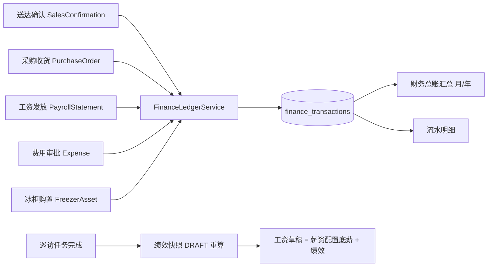

## 产品概述
围绕「供货可视化、商品可选、金额只记流水、财务总账、工资与绩效自动化」六项改造，把系统从“有支付意味的业务流”调整为“线下交易 + 系统只记账”，并补齐财务与绩效的数据闭环。

## 核心功能
### 任务一 供货确认显示真实商品名
- 厂商供货确认页每一行的 SKU 显示为「商品编码 · 商品名称」，不再出现 UUID 片段。
- 采购单列表、供货确认、采购建议中的商品文案统一，去掉重复编码前缀。

### 任务二 新增「沁爽矿泉水」并可选入采购
- 主数据新增一条独立 SKU「沁爽矿泉水」（编码 QS-SKU-035，550ml/瓶×24 瓶，含参考进价与建议零售价），系统管理员可在主数据页直接新建 SKU。
- 采购建单支持「从全部 SKU 手工加行」（选商品、数量、含税单价），矿泉水等无补货需求的商品也能直接采购。

### 任务三 金额只记流水，不做在线支付
- 交易全部线下完成，系统只保留流水：收入、支出、调整三类，逐笔记录日期、金额、来源单据、经办人、备注。
- 必须落流水的场景：饮料送达商家确认（收入）、采购收货（进货支出）、工资发放（工资支出）、费用审批通过（公司物品采购 / 冰柜购置 / 其他支出）。
- 同一来源单据重复触发不重复记账（幂等），每笔流水可回溯到业务单据。

### 任务四 财务总账与公司物品采购
- 新增「财务总账」页面：收入、支出、净利润三个汇总指标，支持按月与按年两种统计口径，并列出逐月/逐年明细与流水清单。
- 页内含「公司物品采购」录入与列表：物品名称、类别、金额、发生日期、凭证上传；提交后进入待审批，审批通过自动计入支出流水。
- 公司物品采购、工资、冰柜购置等支出在同一张流水表里可筛选查看，利润由流水汇总得出。

### 任务五 工作台去掉月度净利润
- 今日工作台不再展示「月度净利润」指标卡（片区经理与财务两个视角），损益页保持不变。

### 任务六 绩效与工资自动化
- 巡访任务提交或判定完成时，自动重算该业务员当月绩效快照（未复核状态），工资生成时自动取用。
- 绩效只按「新签合同奖励 + 活动达成奖励」计算；快照明细不再出现有效巡访奖励、确认销量提成、扣减、调整，也不再提供更正单入口。
- 新增「薪资配置」：按员工维护月薪与生效日期，支持历史版本；工资草稿自动等于底薪 + 绩效，生成时自动取当月生效底薪，无需手输。


## 技术栈
沿用现有栈，不引入新框架：
- 后端：FastAPI + SQLAlchemy 2（声明式模型）+ Alembic 迁移 + PostgreSQL；服务层/仓储层分层，`AuditService` 统一审计，`DomainError/ConflictError` 统一错误。
- 前端：React + TypeScript + Tailwind；复用 `PageHeader`、`DataTable`、`MetricCard`、`StatusBadge`、`ErrorState/LoadingBlock`、`ToastStack`、`useApiQuery/useApiMutation`。
- 金额一律整数分 `*_fen`；业务日按 Asia/Shanghai。

## 实施方案

### 1. SKU 名称随单返回（任务一）
后端把商品信息内联进采购单行视图，前端不再依赖一次额外的 id→名称映射：
- `PurchaseOrderLineView` 增加 `sku_code`、`sku_name`（同时保留 `sku_id`）。
- `_order_view` 用一次 `Sku.id.in_(ids)` 批量取名称建映射（避免 N+1），与 `InventorySummaryItem` 既有做法一致。
- 前端 `Procurement.tsx` 的 `OrderLine` 增加两列，渲染 `code · name`；兜底文案从 `${id.slice(0,8)}…` 改为「未知商品」，并修掉采购建议里 `sku_code` 与 `skuName()` 重复拼接。

### 2. 矿泉水 SKU 与手工选品（任务二）
- 新增 `POST /api/admin/master-data/skus`（`settings` 能力）：校验编码唯一、品牌存在、价格非负，写 `Sku` + 审计事件；主数据页 SKU tab 增加「新建 SKU」面板（与片区新建面板同构）。
- 演示环境在 `demo_dataset.py` 定义矿泉水 SKU 常量，`demo_business_seeder` 幂等补建（`QS-SKU-035` 排在编码末位，不影响既有 `_skus(n)` 取数）。
- `/procurement/sku-options` 增加 `purchase_price_fen` 以便前端预填单价。
- 采购建单区增加「手工加行」：SKU 下拉（按所选品牌查询）+ 数量 + 含税单价 + 添加，追加到草稿行；后端 `create_order` 已有的 SKU/数据域校验继续兜底。

### 3. 流水基座（任务三）
- 扩展 `finance_transactions`：`source_kind` 增加 `SALES_REVENUE / PAYROLL / ASSET / COMPANY_PURCHASE`；新旧值并存以兼容历史；新增幂等唯一索引 `(related_object_type, related_object_id, tx_type, source_kind)`，冲突时回读既有行，保证重复点按不重复记账。
- 新增 `FinanceLedgerService`：`record_income / record_expense` 内部统一 `_record`（校验 amount≠0、写审计、幂等），并提供 `summary(granularity=month|year)` 与 `list_transactions`。
- 在业务服务的状态迁移点写流水（同事务，失败整体回滚，避免“业务成功但没账”）：
  - 送达确认生成 `SalesConfirmation` → 收入（`SALES_REVENUE`）；
  - `receive_purchase_order` → 进货支出（`PROCUREMENT`，金额=行含税金额合计）；
  - `payroll.mark_paid` → 工资支出（`PAYROLL`，金额=`gross_pay_fen`）；
  - `expense.approve_expense` → 支出（按费用类型映射 `PROCUREMENT/FREEZER_PURCHASE→ASSET/OTHER→OPEX`）；
  - `freezer.purchase` → 资产支出（`ASSET`，金额=`purchase_price_fen`）。
- 明确“只记账不支付”：不新增任何支付/退款接口，现有 `pay` 仅表示“线下已发放，登记流水”。

### 4. 财务总账页（任务四）
- 新增 `backend/app/api/finance.py`：`GET /api/finance/ledger/summary`（granularity=month|year，返回收入/支出/利润与分桶明细）、`GET /api/finance/ledger/transactions`、`POST /api/finance/company-purchases`（包装 `ExpenseService.create_expense`，type=PROCUREMENT/OTHER）、审批/驳回、凭证上传（复用 `FileService.save_upload`）。
- 新增前端 `FinanceLedger.tsx`：年度/月度切换、三张汇总卡、分桶收支表 + 迷你柱状、公司物品采购录入与列表（含审批按钮）、流水明细（按类型/日期筛选）。
- 登记 `nav-config.ts`：`/finance/ledger`，`required: MODULE.FINANCE`，`onlyFor: ["FINANCE","SYSTEM_ADMIN"]`。

### 5. 工作台清理（任务五）
- `workbench_service._ROLE_METRICS` 中移除片区经理与财务的 `M_MONTHLY_NET_PROFIT`；指标定义与损益页保留，前端无需改动（通用卡片循环）。

### 6. 绩效与工资（任务六）
- 口径精简：`performance_engine` 只产出 `NEW_CONTRACT`、`ACTIVITY_ACHIEVED` 两类行，`visit_bonus/sales_commission/deduction/adjustment` 恒为 0；`net = 新签 + 活动`。
- 快照模型列保留（恒 0）以避免破坏性迁移；`_collect_approved_items` 停用，`apply_adjustment` 改为返回明确错误（不再接受扣减/调整）。
- 自动重算：新增 `PerformanceSnapshotService.refresh_month(user_id, biz_date)`——无快照则建 `DRAFT`，`DRAFT` 就地重算，`CONFIRMED/REVIEWED` 跳过（已审数据不可变）；在 `visit_service.submit()`（`status=COMPLETED`）与 `judge()` 完成分支调用（同事务，异常只记录告警不阻断现场提交）。
- 工资：`_resolve_snapshot` 放宽为“取当月最新快照（含未复核）”，并写入 `basis_json` 便于追溯。
- 薪资配置：新增 `salary_configs` 表（`user_id + effective_from` 唯一、`base_salary_fen`、`is_active`、数据集字段）与 `SalaryConfigService`；`generate_statement` 支持 `base_salary_fen` 缺省时按 `period_month` 首日取生效配置，缺失则报 `SALARY_CONFIG_MISSING`；工资页新增「薪资配置」区块，生成表单底薪改为自动带出（可覆盖）。

## 架构与数据流

- 流水为唯一账本：新总账页只读 `finance_transactions`；既有损益页保持原口径不动，避免双写导致重复计数。
- 幂等：唯一索引 + 冲突回读；重复点击/重试不产生第二笔。

## 目录结构（新建 / 修改）
```
backend/
├── app/
│   ├── models/
│   │   ├── finance.py                     # [MODIFY] source_kind 扩展 + 幂等唯一索引
│   │   └── payroll.py                     # [MODIFY] 新增 SalaryConfig 模型
│   ├── schemas/
│   │   ├── finance.py                     # [NEW] 汇总/流水/公司物品采购请求响应
│   │   ├── procurement.py                 # [MODIFY] 行视图补 sku_code/sku_name；SKU 选项补进价
│   │   └── payroll.py                     # [MODIFY] 薪资配置入参；底薪可缺省
│   ├── api/
│   │   ├── finance.py                     # [NEW] 总账汇总、流水、公司物品采购、凭证上传
│   │   ├── procurement.py                 # [MODIFY] _order_view 内联 SKU 名称
│   │   ├── admin_master_data.py           # [MODIFY] POST /skus 新建 SKU
│   │   ├── payroll.py                     # [MODIFY] 薪资配置 CRUD
│   │   └── performance.py                 # [MODIFY] 停用更正单入口
│   ├── services/
│   │   ├── finance_ledger_service.py      # [NEW] 记账 + 汇总 + 幂等
│   │   ├── salary_config_service.py       # [NEW] 薪资配置解析与维护
│   │   ├── replenishment_service.py       # [MODIFY] 送达确认写收入流水
│   │   ├── procurement_service.py         # [MODIFY] 收货写进货支出
│   │   ├── payroll_service.py             # [MODIFY] 发放写工资支出；底薪取配置；快照放宽
│   │   ├── expense_service.py             # [MODIFY] 审批通过写支出流水
│   │   ├── freezer_service.py             # [MODIFY] 购置写资产支出流水
│   │   ├── performance_engine.py          # [MODIFY] 仅新签 + 活动
│   │   ├── performance_snapshot_service.py# [MODIFY] 精简采集 + refresh_month
│   │   ├── visit_service.py               # [MODIFY] 完成钩子触发重算
│   │   ├── workbench_service.py           # [MODIFY] 移除净利润卡
│   │   └── demo_business_seeder.py        # [MODIFY] 幂等补建矿泉水 SKU
│   └── repositories/schedule... (无)
├── alembic/versions/xxxx_t35_ledger_salary.py  # [NEW] 一次性迁移
└── tests/
    ├── test_t35_procurement_sku.py        # [NEW] 行内 SKU 名称、手工加行
    ├── test_t35_finance_ledger.py         # [NEW] 四类流水、幂等、汇总、公司物品采购
    ├── test_t35_salary_config.py          # [NEW] 底薪取配置、缺失报错
    ├── test_t19_performance.py            # [MODIFY] 绩效新口径
    └── test_t27_workbench.py              # [MODIFY] 卡片移除断言

frontend/src/
├── pages/
│   ├── FinanceLedger.tsx                  # [NEW] 总账 + 公司物品采购 + 流水
│   ├── Procurement.tsx                    # [MODIFY] 商品名称展示、手工加行、去重复拼接
│   ├── MasterData.tsx                     # [MODIFY] 新建 SKU 面板
│   ├── Performance.tsx                    # [MODIFY] 构成列与快照卡精简
│   └── Payroll.tsx                        # [MODIFY] 薪资配置区块、底薪自动带出
└── lib/nav-config.ts                      # [MODIFY] 注册 /finance/ledger
```

## 关键代码结构
```python
# app/services/finance_ledger_service.py
SOURCE_INCOME_SALES = "SALES_REVENUE"
SOURCE_EXPENSE_PAYROLL = "PAYROLL"
SOURCE_EXPENSE_ASSET = "ASSET"
SOURCE_EXPENSE_COMPANY = "COMPANY_PURCHASE"

class FinanceLedgerService:
    def record_income(self, actor, *, biz_date: date, amount_fen: int,
                      source_kind: str, related_type: str, related_id: UUID,
                      note: str | None = None) -> FinanceTransaction: ...
    def record_expense(self, actor, *, biz_date: date, amount_fen: int,
                       source_kind: str, related_type: str, related_id: UUID,
                       note: str | None = None) -> FinanceTransaction: ...
    def summary(self, actor, *, granularity: Literal["month", "year"],
                year: int, month: int | None = None) -> LedgerSummary: ...
    def list_transactions(self, actor, *, date_from: date | None,
                          date_to: date | None, source_kind: str | None,
                          limit: int = 200) -> list[FinanceTransaction]: ...
```
```python
# app/models/payroll.py（新增）
class SalaryConfig(Base, AuditMixin, DatasetMixin):
    __tablename__ = "salary_configs"
    # 唯一：(user_id, effective_from)；金额单位分
    user_id: Mapped[UUID]
    base_salary_fen: Mapped[int]
    effective_from: Mapped[date]
    effective_to: Mapped[date | None]
    is_active: Mapped[bool]
```

## 实施注意事项
- 迁移只做“加列/加索引/放宽 CHECK”，不删除绩效历史列，保证既有数据可读；绩效四项恒 0 并由前端隐藏。
- 流水写入必须在业务事务内（同一 `db_session`），失败整体回滚；`amount_fen` 为 0 时不写（模型有 `<> 0` 约束）。
- 幂等冲突按 `IntegrityError` 捕获后回读，禁止吞掉其他约束错误。
- 自动绩效重算只针对“当次完成任务的业务员 + 其当月”，避免全表扫描；已复核快照不改写。
- 测试基线（后端 696 / 前端 71）必须保持；绩效口径变更需同步修正既有断言，不做“跳过”。
- 前端新增页面沿用现有 slate 卡片风格与 `--color-brand`，不引入新的 UI 库。


## 设计目标
新增「财务总账」页（/finance/ledger），沿用系统现有克制的后台风格：白底卡片 + slate 文字层级 + 品牌色强调，信息密度高、数字优先，避免花哨装饰。

## 页面结构（自上而下）
1. **顶部工具栏**：页面标题「财务总账」+ 口径切换（按月 / 按年）+ 年份选择 + 月份选择（按月时出现）+ 刷新；右侧「导出」与「录入公司物品采购」主按钮。
2. **汇总指标区**：三张指标卡（本月/本年收入、支出、净利润），大号数字 + 单位「元」，副行显示口径与统计区间；净利润按正负着色（正为品牌绿、负为玫瑰红）。
3. **收支趋势区**：按月时展示 12 个月的收入/支出双色柱状（纯 CSS 高度条），按年时展示近 5 年横条；每根柱可悬浮显示金额。
4. **公司物品采购区**：左侧录入表单（物品名称、类别、金额、发生日期、凭证上传、备注），右侧列表表格（日期、物品、类别、金额、状态徽标、审批操作）；提交后状态为「待审批」。
5. **流水明细区**：筛选条（收入/支出、来源类型、日期区间）+ 表格（日期、类型徽标、来源、金额、关联单据、备注、经办人），空态给出「本月暂无流水」并提示录入入口。

## 交互
- 口径切换即时重算，不整页刷新；切换时保留筛选条件。
- 金额输入以元展示、后端存分，失焦格式化千分位。
- 审批操作二次确认，成功后该行状态与汇总数字同帧更新。
- 所有错误态使用现有 ErrorState（403 提示权限、401 提示重新登录）。
