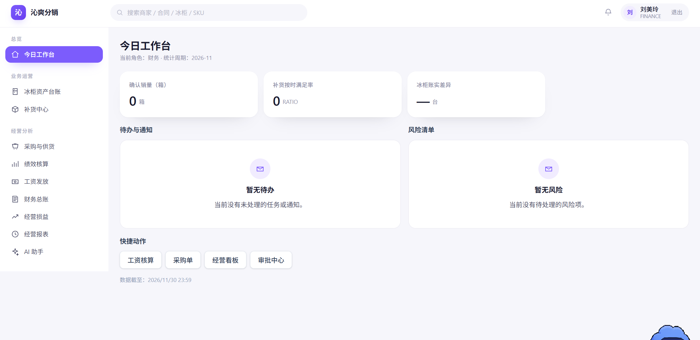

# 沁爽饮料分销管理平台

面向 B2B 饮料分销场景的全栈管理系统：覆盖商家、合同、冰柜、巡访、补货、绩效与财务总账，并内置 **AI 助手**——支持自然语言问数、自动生成图表、检索制度知识库。

> 数据隔离与权限控制贯穿全链路：数据范围只由服务端按登录账号解析，客户端与模型均无法指定。

## 目录

- [功能概览](#功能概览)
- [技术栈](#技术栈)
- [系统架构](#系统架构)
- [快速开始](#快速开始)
- [环境变量](#环境变量)
- [AI 助手设计](#ai-助手设计)
- [安全设计](#安全设计)
- [测试与质量](#测试与质量)
- [目录结构](#目录结构)
- [已知边界](#已知边界)
- [Roadmap](#roadmap)

## 功能概览

| 模块 | 说明 |
|---|---|
| 今日工作台 | 按角色聚合待办：待访任务、整改复查、审批、补货提醒 |
| 商家管理 | 建档、归属分配、等级与状态、片区归属、就近检索 |
| 合同管理 | 全生命周期（草稿 → 待审批 → 生效 → 续签/终止）、版本变更、附件 |
| 冰柜资产 | 投放/撤柜、押金、维修工单、巡访检查与状态流转 |
| 巡访作业 | 周排班、临时任务、到店签到、陈列与冰柜检查、整改复查 |
| 补货与履约 | 需求汇总、补货单、履约跟踪、缺货预警 |
| 采购与供应商 | 供应商管理、采购入库、费用记账 |
| 财务 | 绩效核算、工资发放、收支流水、利润分析 |
| 报表与监控 | 指标看板、风险清单、导出 |
| **AI 助手** | 自然语言问数出图、制度知识检索、业务工具调用 |
| 系统管理 | 用户与授权、片区、主数据、审计日志 |

## 技术栈

**前端**：React 19 · Vite · TypeScript · Tailwind CSS v4（CSS-first `@theme` 设计令牌）· React Router 7 · ECharts 6

**后端**：Python 3.12 · FastAPI · Pydantic v2 · SQLAlchemy 2.0 (async) · Alembic · PyJWT · argon2

**基础设施**：PostgreSQL 16 + PostGIS · Redis 7 · Qdrant（向量检索，可选）· MinIO（对象存储）

**AI**：OpenAI 兼容协议（默认 DeepSeek）· sentence-transformers `bge-small-zh`（可选依赖）

**工程**：uv · ruff · mypy · pytest · pnpm · vitest · Playwright · GitHub Actions

## 系统架构

```
                 ┌──────────────────────────────────────┐
  浏览器 ────────►│  React SPA (Vite)                    │
                 │  设计令牌 / 共享组件 / 权限裁剪菜单    │
                 └───────────────┬──────────────────────┘
                                 │ Bearer JWT + refresh
                 ┌───────────────▼──────────────────────┐
                 │  FastAPI                             │
                 │  安全头 → 限流 → 鉴权 → 能力校验       │
                 │  路由 → 服务 → 仓储 → ORM             │
                 └───┬──────────────┬───────────────────┘
                     │              │
           ┌─────────▼───┐  ┌───────▼────────┐  ┌──────────────┐
           │ PostgreSQL  │  │ Redis          │  │ Qdrant       │
           │  + PostGIS  │  │ 限流/幂等/会话   │  │ 知识库向量    │
           └─────────────┘  └────────────────┘  └──────────────┘
                     │
           ┌─────────▼──────────────────────────────────────┐
           │ AI 层：AiGateway（超时 / 断路器 / 审计 / 降级）  │
           │  ├─ 知识库 RAG（向量 + 关键词降级）             │
           │  ├─ Text2SQL（语义层 → 五段流水线 → 图表）      │
           │  └─ MCP 工具网关（read / write / draft / suggest）│
           └────────────────────────────────────────────────┘
```

## 快速开始

### 前置依赖

- Python 3.12、[uv](https://github.com/astral-sh/uv)
- Node.js 22+、pnpm
- Docker（用于启动 PostgreSQL / Redis / Qdrant / MinIO）

### 1. 启动基础设施

```bash
# 必填：数据库密码、对象存储密钥
export POSTGRES_PASSWORD=your-strong-password
export S3_ACCESS_KEY=minio-user
export S3_SECRET_KEY=minio-password

docker compose -f infra/docker-compose.yml up -d postgres redis qdrant minio
```

### 2. 后端

```bash
cd backend
cp ../.env.example .env          # 修改 DATABASE_URL / REDIS_URL / SECRET_KEY
uv sync                          # 可选：[rag] 装上本地 embedding（约 2GB）
alembic upgrade head
uvicorn app.main:app --host 127.0.0.1 --port 8000 --reload
```

- API 文档：http://127.0.0.1:8000/docs
- 健康检查：http://127.0.0.1:8000/healthz

### 3. 前端

```bash
cd frontend
pnpm install
pnpm dev        # http://localhost:5173，/api 自动代理到 8000
```

### 4. 首任管理员

空库首次启动时，在 `.env` 中开启引导（仅首次生效，之后请移除密码）：

```dotenv
INITIAL_ADMIN_BOOTSTRAP=true
INITIAL_ADMIN_USERNAME=admin
INITIAL_ADMIN_PASSWORD=<你的初始密码>
INITIAL_ADMIN_DISPLAY_NAME=系统管理员
```

其余账号一律由管理员在「用户与账号管理」中创建，系统**不提供注册入口**；新账号通过一次性激活凭据自设密码。

### 5. 演示数据（可选）

```dotenv
DEMO_DATA_ENABLED=true
```

播种逻辑位于 `backend/app/services/demo_*_seeder.py`，会写入独立的**演示数据域**，与生产数据互不可见。演示账号密码由播种配置决定，请勿在生产环境开启。

## 环境变量

| 变量 | 说明 | 必填 |
|---|---|---|
| `DATABASE_URL` | 数据库连接串（asyncpg） | ✅ |
| `REDIS_URL` | 限流 / 幂等 / 会话 | ✅ |
| `SECRET_KEY` | JWT 签名密钥，长度随机 | ✅ |
| `ENVIRONMENT` | `dev` / `test` / `production` | ✅ |
| `S3_ENDPOINT_URL` / `S3_ACCESS_KEY` / `S3_SECRET_KEY` / `S3_BUCKET` | 对象存储（合同、照片） | ✅ |
| `QDRANT_ENABLED` / `QDRANT_URL` | 向量检索开关，关闭时自动降级关键词 | ⬜ |
| `DEMO_DATA_ENABLED` | 是否允许演示数据播种 | ⬜ |
| `AI_CHAT_PROVIDER` | `mock`（纯规则） / `moonshot` / `openai`（任意 OpenAI 兼容端点） | ⬜ |
| `AI_MODEL` / `AI_BASE_URL` / `AI_API_KEY` | 对话模型配置 | ⬜ |
| `AI_TIMEOUT_SECONDS` | 单次模型调用时限（需 ≥ 推理模型实际耗时） | ⬜ |

> 完整清单见 `.env.example`。**任何密钥都不要提交到仓库**，`.env` 已在 `.gitignore` 中忽略。

## AI 助手设计

### 三条通道

请求先做**确定性路由**，命中规则即调用对应工具；否则交给模型规划：

| 通道 | 触发条件 | 产出 |
|---|---|---|
| 规则工具 | 命中业务关键词（商家 / 冰柜 / 巡访 / 绩效 / 补货 / 风险 / 合同） | 列表、汇总卡片 |
| 知识库 RAG | 制度类疑问句 | 带出处的条款答复 |
| Text2SQL | 分析类问句且无规则命中 | 数据表 + 图表 + 结论 |

### Text2SQL 五段流水线

```
问题 → 语义检索 → 上下文构建 → 模型规划(唯一 LLM 阶段)
     → 计划校验 → SQL 编译 → 只读执行
```

三条硬约束：

1. **LLM 只出现在规划阶段**，其余为确定性代码，可审计、可复现；
2. **`dataset_id` 与行级范围由服务端注入**，不进入提示词，模型与客户端均无法指定；
3. **编译参数化 SQL，只读事务 + 超时 + 行数上限**；行级范围无法落到实体时明确拒绝而非放宽。

### 图表是确定性规则

不是让模型画图，而是按结果形态判定：1 个维度 + 1~2 个指标才出图；时间粒度且 ≥2 个点出折线；占比语义 + 2~8 个分类出饼图；其余柱状；超过 50 点截断，空结果不出图。

### 降级链

所有模型调用经 `AiGateway`（超时、断路器、审计、降级）。模型不可用时自动退化为**规则化答案**，保证 AI 故障不导致接口 500。

## 安全设计

| 层次 | 措施 |
|---|---|
| 传输 / 入口 | 安全响应头中间件、接口限流（Redis 计数）、请求体校验 |
| 身份 | JWT access + refresh；密码 argon2；角色/密码版本变更即旧 token 失效 |
| 授权 | 角色 → 能力（ability）→ 模块级校验；**行级范围**由用户 × 片区 × 品牌授权表派生 |
| 数据隔离 | 全表 `dataset_id` 隔离，查询按数据集主键过滤 |
| 注入防护 | SQL 全参数化；知识库外部文本经注入检测后返回 |
| 错误处理 | 统一错误信封；500 不暴露堆栈、SQL、密钥；权限拒绝埋点仅记录角色与模块 |
| 审计 | 关键动作与 AI 调用落审计表，含调用耗时、命中工具、降级原因 |

## 测试与质量

```bash
# 后端
cd backend
uv run ruff check .
uv run mypy .
uv run pytest -q            # 745 passed

# 前端
cd frontend
pnpm typecheck
pnpm lint
pnpm test                   # 78 passed
pnpm e2e                    # Playwright
```

CI（`.github/workflows/ci.yml`）在 push / PR 时执行：后端 ruff + mypy + pytest，前端类型检查 + 测试 + 构建。

## 目录结构

```
.
├── backend/
│   ├── app/
│   │   ├── api/           # 路由层（按业务域拆分）
│   │   ├── core/          # 配置、鉴权、限流、异常处理、中间件
│   │   ├── db/            # 会话与基类
│   │   ├── models/        # ORM 模型
│   │   ├── schemas/       # Pydantic 契约（请求/响应/模型输出）
│   │   ├── repositories/  # 查询拼装
│   │   ├── services/      # 业务规则
│   │   ├── mcp/           # 工具网关（目录/注册/确认/审批矩阵）
│   │   ├── semantic/      # 语义层目录
│   │   ├── retrieval/     # 语义检索与向量存储
│   │   └── text2sql/      # 规划 / 校验 / 编译 / 执行
│   ├── config/semantic_layer.yaml   # 指标与维度口径定义
│   ├── alembic/           # 数据库迁移
│   └── tests/
├── frontend/
│   └── src/
│       ├── components/    # 共享组件（表格/筛选/分页/徽章/图表）
│       ├── pages/         # 业务页面
│       ├── lib/           # 请求封装、鉴权、权限裁剪
│       └── index.css      # 设计令牌
├── infra/                 # docker-compose 与生产镜像
├── docs/                  # 设计文档（数据模型、权限、审计、UAT）
└── .github/workflows/     # CI
```

### 项目截图展示



## 已知边界

- **单租户形态**：面向单一企业的部署，未实现订阅计费与自助开通，严格意义上不是 SaaS。
- **财务流水无片区维度**：片区经理查询总账会被明确拒绝（数据模型限制，非权限缺陷）。
- **入参契约可再收紧**：请求模型尚未统一 `extra="forbid"`，校验失败仍走框架默认 422 响应。
- **仅桌面端**：移动端未适配，规划路线为 PWA + 混合壳复用同一套代码。

## Roadmap

- [ ] 账龄与回款分析、坏账预警
- [ ] 移动端（PWA → 混合壳），离线巡访队列与幂等重放
- [ ] 租户化改造（`tenant_id` + PostgreSQL RLS + 计量计费）
- [ ] 语义层支持租户级自定义口径
- [ ] 可观测性：指标看板、模型成本与调用质量监控

## 许可

仓库未声明开源许可证。如需开源，建议补充 `LICENSE`（如 MIT / Apache-2.0）。
